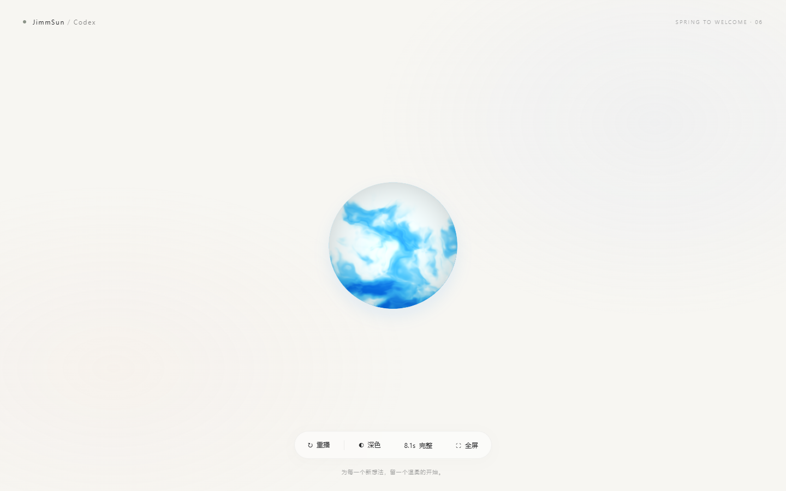

# Codex Welcome Animation

为 Windows Codex 准备的一段个人欢迎动画：全屏蓝色云雾以果冻弹簧感收成小球，小球内缩消失，OpenAI Logo 旋转长大、逐渐减速，再蓄力弹射向上，带出连笔书写的 **welcome JimmSun**，最后淡出进入 Codex。



## 两个版本

| 版本 | 速度 | 动画时长 | 欢迎词书写 | 启动入口 |
| --- | --- | --- | --- | --- |
| **5.1 秒 · 推荐** | 1.6× | 5.0625 秒，显示为约 5.1 秒 | 约 2.19 秒 | `Launch-5.1s.cmd` |
| **8.1 秒 · 完整版** | 1× | 8.1 秒 | 3.5 秒 | `Launch-8.1s.cmd` |

两个版本来自同一条时间线，快速版就是预览中选定的 1.6× 版本。时长指动画本身；启动浏览器和 Codex 所需时间取决于电脑状态。

## Windows 安装

需要已安装 **Microsoft Edge** 和 **Codex 桌面版**。日常使用不需要 Node.js、Python、npm、管理员权限或运行预览服务器。

1. 在本仓库点击 **Code → Download ZIP**，解压到普通文件夹。
2. 双击 **`Install.cmd`**。
3. 桌面和开始菜单会出现 **`Codex (5.1s)`**、**`Codex (8.1s)`** 两个快捷方式。日常使用第一个即可。

安装文件会复制到 `%LOCALAPPDATA%\CodexWelcome`，因此之后移动或删除下载目录不会影响快捷方式。原来的 Codex 程序和快捷方式保持不变。

如果自动检测不到 Codex，可在 PowerShell 中进入解压目录，明确指定程序位置：

```powershell
powershell.exe -NoProfile -ExecutionPolicy Bypass -File .\Install.ps1 -CodexPath "C:\path\to\Codex.exe"
```

`ExecutionPolicy Bypass` 只用于当前脚本进程，不修改系统执行策略。安装器也支持 `-InstallRoot` 指定其他安装文件夹。

## 使用方式

- 点击 **Codex (5.1s)**：播放快速欢迎动画，然后进入 Codex。
- 点击 **Codex (8.1s)**：播放完整版，然后进入 Codex。
- 动画中按 **Esc**：跳过动画，进入 Codex。
- 不想安装：解压后直接双击相应的 `Launch-*.cmd`，但此时要保留解压目录。
- 如果 Windows 没有启用 VBScript，可直接运行下列 PowerShell 命令，参数 `full` 对应完整版：

```powershell
powershell.exe -NoProfile -ExecutionPolicy Bypass -File .\launcher\Launch.ps1 -Variant fast
```

Codex 已运行时会回到现有窗口；未运行时会启动程序。启动器使用独立的 Edge 配置目录播放全屏动画，并在结束后只关闭自己的动画窗口。它不读取你的 Chrome/Edge 登录资料。

启动时在随机的 `127.0.0.1` 端口短暂提供本地文件，完成后关闭；不对局域网开放，也不依赖网络。窗口可用时，Codex 会在动画后方准备就绪，最后通过窗口透明度淡出交接。异常情况下最长等待 45 秒后尝试直接打开 Codex。

## 浏览器预览

双击 `docs/index.html` 即可离线预览。页面提供重播、深浅色切换、5.1/8.1 秒切换和全屏按钮。浏览器预览只播放动画，不会启动电脑上的 Codex。

- `docs/fast.html`：默认 5.1 秒预览。
- `docs/full.html`：默认 8.1 秒预览。
- `docs/animation.html?play=1&variant=fast`：纯动画入口。
- `docs/animation.html?play=1&variant=full&theme=dark`：深色完整版。

为了在本地 HTTP 环境测试，也可以安装 Node.js 后运行：

```sh
node tools/serve.mjs
```

然后打开终端中显示的本地地址。

## 部署到 GitHub Pages

无需构建，也不需要后端：

1. 打开仓库 **Settings → Pages**。
2. 在 **Build and deployment → Source** 选择 **Deploy from a branch**。
3. 分支选择 **main**，文件夹选择 **/docs**，点击 **Save**。
4. 等待 Pages 部署完成，访问设置页给出的站点地址。

例如，本仓库部署后的地址通常是：

```text
https://zhuolin272-dotcom.github.io/codex-welcome-animation/
https://zhuolin272-dotcom.github.io/codex-welcome-animation/?variant=full
```

这些是启用 Pages 后的预期地址，不代表刚克隆的仓库已经启用。静态站点用于分享和预览；Windows 启动能力由下载后的本地脚本提供。发布源配置参见 [GitHub 官方文档](https://docs.github.com/en/pages/getting-started-with-github-pages/configuring-a-publishing-source-for-your-github-pages-site)。

也可把 `docs/` 中的全部文件上传到任意静态托管服务；保留 `vendor/` 相对路径即可。

## 修改欢迎词与开发

运行不需要 Python。只有重新生成字形时需要 Python 3 和开发依赖：

```sh
python -m pip install -r requirements-dev.txt
python tools/build.py --name JimmSun --greeting welcome
```

`--name` 和 `--greeting` 当前支持 Sacramento 字体包含的拉丁字符，建议使用简短文字以保持版式。字形生成结果保存在 `docs/animation.html`。修改动作、配色和着色器请编辑 `source/animation.template.html`，然后重新运行构建脚本；不要只修改生成文件。重新运行 `Install.cmd` 可将修改更新到本机安装目录。

```text
docs/                         可离线运行、可静态部署的预览
source/animation.template.html  动画、弹簧曲线、云雾着色器与交接逻辑
tools/build.py                SVG 手写字形生成器
launcher/Launch.ps1            本地服务、全屏窗口与 Codex 交接
launcher/Start.vbs             隐藏控制台的快捷方式入口
Install.ps1 / Install.cmd      当前用户安装器
tests/Smoke.ps1               两种速度的真实浏览器完成回调测试
assets/                       图标、字形源、预览图及许可证
```

## 测试与排错

检查资源与 Codex/Edge 检测：

```powershell
powershell.exe -NoProfile -ExecutionPolicy Bypass -File .\launcher\Launch.ps1 -ValidateOnly
```

使用无头 Edge 完整播放两个版本，确认真实的 READY、FADE、COMPLETE 回调；不打开 Codex、不显示全屏窗口：

```powershell
powershell.exe -NoProfile -ExecutionPolicy Bypass -File .\tests\Smoke.ps1
```

日志位于安装目录的 `logs\launch.log`。如果 Codex 更新后更换了安装位置，先重新打开 Codex 再试；也可以重新安装并指定新的 `-CodexPath`。如果显卡不支持 WebGL，蓝球会使用渐变外观，其他动作继续播放。

## 卸载

运行安装目录中的 `Uninstall.ps1` 会删除本项目创建的快捷方式，并保留安装文件。之后可手动删除 `%LOCALAPPDATA%\CodexWelcome`。它不会卸载 Codex 或 Edge。

## 许可证与素材

本项目自写代码使用 MIT 许可证；第三方素材保持各自许可，详见 [NOTICE.md](NOTICE.md)。OpenAI 标志的商标权属于 OpenAI。本项目是个人欢迎动画，与 OpenAI 没有官方隶属或背书关系。
